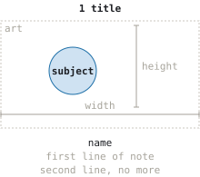
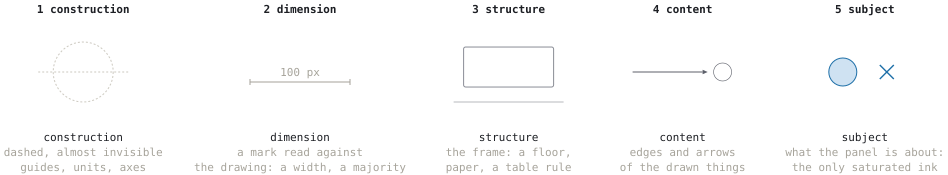
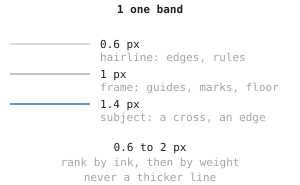
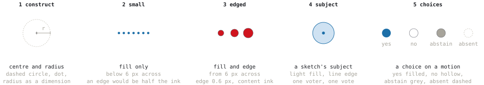
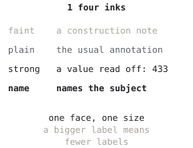
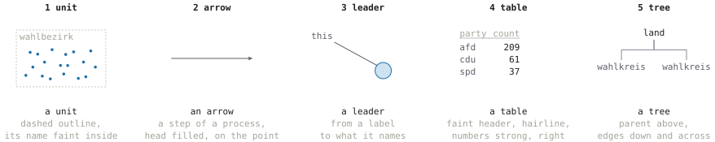

# Style guide

How wahlwerk draws: chamber plots, and the sketches that explain what the engine models.
Every value comes from [`src/wahlwerk_ui/style.py`](src/wahlwerk_ui/style.py), and every
plate on this page is drawn with the library it documents
([`sketch/guide.py`](src/wahlwerk_ui/sketch/guide.py)). After a change to the style,
regenerate the plates:

```bash
uv run python -m wahlwerk_ui.sketch.guide docs/style
```

The reference is a technical drawing, not an illustration: an old architectural plate,
the IR-bands Knowledge diagrams, the PhD capillarity sketches. Thin clean lines, the
construction geometry left visible, every label in one small face, nothing shaded, and
no line thick enough to be the first thing seen.

## 1 The plate



A sketch is a **plate**: a row of panels, numbered from 1. Each panel shows **one idea**.

1. **Title** above the art, with its number: what the panel shows, in a few words.
2. **Art**: the drawing. Default 200 × 140 px; a guide panel is 150 × 100.
3. **Caption** under the art: its **name** (strong), then at most **two lines** of note
   (faint). Three lines of note means two panels.
4. A panel takes the width of its art or of its widest line of text, whichever is larger,
   and the panels sit 24 px apart.

On a web page the panels are separate SVGs (`Plate.to_dict()`) with the title and caption
set as HTML text, so they wrap at phone width. For documentation and print the plate is
one file (`Plate.save(dir)`).

## 2 The ink ladder



**Hierarchy is carried by ink, and only secondarily by weight.** Before adding a stroke,
decide which rung it is on; two strokes on one rung claim to be the same kind of thing.

| Rung | Token | What sits on it |
| --- | --- | --- |
| 1 construction | `CONSTRUCTION`, dashed `2 2` | ring guides, units, axes, a circle being constructed |
| 2 dimension | `DIMENSION` | capped dimension lines, the majority mark |
| 3 structure | `STRUCTURE` | the floor, paper, a table rule, tree edges |
| 4 content | `CONTENT` | edges of the drawn things, arrows, leaders |
| 5 subject | party colours, `SUBJECT_FILL` / `SUBJECT_LINE` | what the panel is about: the only saturated ink |

The layers of every SVG are the rungs, bottom to top: `construction`, `structure`,
`subject`, `dimension`, `labels`. Dimension sits above the subject so a mark can be read
across it.

## 3 Strokes



Every stroke lives in **one band, 0.6 to 2 px**, so a plate reads as one drawing.

| Width | Token | For |
| --- | --- | --- |
| 0.6 px | `STROKE_HAIRLINE_PX` | edges of seats and wedges, table rules |
| 1 px | `STROKE_FRAME_PX` | guides, marks, the floor, arrows |
| 1.4 px | `STROKE_SUBJECT_PX` | the subject as a line: a cross, a subject's edge |

Reach for a **lighter ink before a thinner line**, and never for a thicker one.

## 4 Circles



A circle is a seat, a voter, a mark. It is drawn in five steps of increasing ink:

1. **Construct** it: a dashed circle, its centre as a dot, its radius as a dimension.
   Only in a sketch that explains geometry; otherwise the construction stays implicit.
2. **Small** (under `EDGE_MIN_DIAMETER_PX`, 6 px across): fill only. On a 2 px seat a
   0.6 px edge would be half the ink.
3. **Edged** (from 6 px): fill plus a 0.6 px edge in the content ink.
4. **A sketch's subject**: `SUBJECT_FILL` with a `SUBJECT_LINE` edge; a voter or a vote
   inside it as a small filled dot.
5. **A mandate's choice** (`primitives.CHOICES`): **yes** filled, **no** hollow,
   **abstain** grey, **absent** dashed, as construction: a seat with nobody voting from it.

Seats in a hemicycle are laid out by `seat_layout`: rings proportional to their length,
seats ordered left to right by angle, integer arithmetic for the split so a layout is the
same on every machine.

## 5 Labels



**One face, one size, four inks.** Every label is `FONT_FAMILY` (IBM Plex Mono, the code
face of wahlwerk-site) at `FONT_SIZE_PX` (11 px), which is also the smallest text
allowed anywhere.

| Ink | For |
| --- | --- |
| faint | a construction note: `seats`, `majority 315`, a unit's name, a table header |
| plain | the usual annotation, a legend label |
| strong | a value being read off: a count, a total |
| strong + `LABEL_WEIGHT` | the name of the subject, a panel's title |

A plate that needs a bigger label needs fewer labels. In-plot text is lowercase, German
terms of art included (`wahlkreis`, `zweitstimme`). No em dashes.

## 6 Furniture



The same few pieces everywhere ([`sketch/primitives.py`](src/wahlwerk_ui/sketch/primitives.py)):

- **unit**: a dashed outline, its name faint inside its top left corner. A Wahlbezirk, a
  Wahlkreis: an area the law counts in.
- **arrow**: a step of a process; 1 px, the head filled and ending on the point.
- **leader**: from a label to what it names, a small dot on the thing.
- **table**: faint header, hairline rule, plain cells, numbers strong and right aligned;
  an absent value is a faint `·`, never a `0`.
- **tree**: the parent above, edges down, across and down to each child.
- **Stimmzettel** and **chamber** are compositions of these, kept in the library because
  more than one sketch draws them.

## 7 Colour

Every colour is a `Tone` with a light and a dark value. A drawing shown on a page follows
the theme (`prefers-color-scheme`, `data-theme`, JupyterLab's `data-jp-theme-light`); a
saved drawing carries the light values written in place, since Illustrator and Inkscape
read no CSS variables.

- **The inks** of the ladder and the labels are greys warm enough to sit on
  wahlwerk-site's paper (`--bg`), each with a dark value for the dark theme.
- **The subject of a sketch** that is not a party is `SUBJECT_FILL` / `SUBJECT_LINE`, a
  quiet blue, the colour of the liquid in the PhD sketches: light fill, line edge.
- **Party colours** have their own module and page, since that list grows with every
  election: see [Party colours](#party-colours) below.
- A colour that is not in `style.py` or `parties.py` does not exist.

## Party colours

The rules, in short (the full statement is the docstring of
[`parties.py`](src/wahlwerk_ui/parties.py)):

- **Data, never chrome.** A party colour encodes a party in a seat, a wedge or a swatch.
- **One key per name stood under.** Keys are the party ids of wahlwerk-data's registry; a
  renamed party is a new key, which may share its predecessor's colour (`pds`, `linke`).
- **Both themes**; the dark value is the lighter one.
- **A carbon-dark party is a dark slate, never black**: black reads as ink.
- **The source.** wahlwerk-site's `lib/tokens.ts` copies these values; change them in
  `parties.py` first, then regenerate.

The list itself, with every value in both themes, is
**[docs/party-colours.md](docs/party-colours.md)**, generated from the module.

## Files

- **Generated, never edited.** Illustrator rewrites SVG on save and drops the structure.
  Place a sketch in a document of your own and draw hand additions on a layer there.
- **Readable.** Named layers with Inkscape layer attributes, one group per party
  (`party-spd`), one id per seat (`seat-spd-001`), ids prefixed by panel on a plate
  (`stimmzettel.layer-subject`), one style block at the top with every selector under the
  drawing's id.
- **Deterministic.** The same input gives the same file: ids come from a hash of what is
  drawn, crowds from a fixed sequence, never from a random seed.
