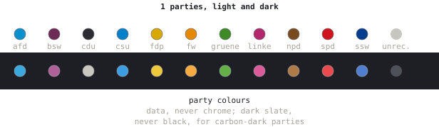

# Party colours

Generated from [`src/wahlwerk_ui/parties.py`](../src/wahlwerk_ui/parties.py) by
`uv run python -m wahlwerk_ui.sketch.guide docs/style`; edit the module, not this page.
The rules are in the module's docstring and in [STYLE.md](../STYLE.md#party-colours).

| id | party | light | dark |
| --- | --- | --- | --- |
| `afd` | AfD | `#0a8fcf` | `#3aa9e0` |
| `bsw` | BSW | `#6d2a55` | `#b0619a` |
| `cdu` | CDU | `#2a2c31` | `#c9c7c0` |
| `cdu-csu` | CDU/CSU, the caucus | `#2a2c31` | `#c9c7c0` |
| `csu` | CSU | `#0080c8` | `#3a9ee0` |
| `fdp` | FDP | `#d9a800` | `#f0c93a` |
| `fw` | Freie Wähler | `#e58a00` | `#f5ab40` |
| `gruene` | BÜNDNIS 90/DIE GRÜNEN | `#3e8a25` | `#62b046` |
| `linke` | Die Linke | `#b3276d` | `#dc5a98` |
| `npd` | NPD | `#7a4a1f` | `#b07a48` |
| `pds` | PDS | `#b3276d` | `#dc5a98` |
| `spd` | SPD | `#d0141e` | `#ec4a4f` |
| `ssw` | SSW | `#003c8f` | `#4f7fcf` |

Seats whose party is not on record: `#c8c6c0` / `#4f5158`.
A label without a colour here takes the next fallback, in order of appearance: `#8c6d31`, `#6b6ecf`, `#7b4173`, `#637939`, `#9c6b5e`.
